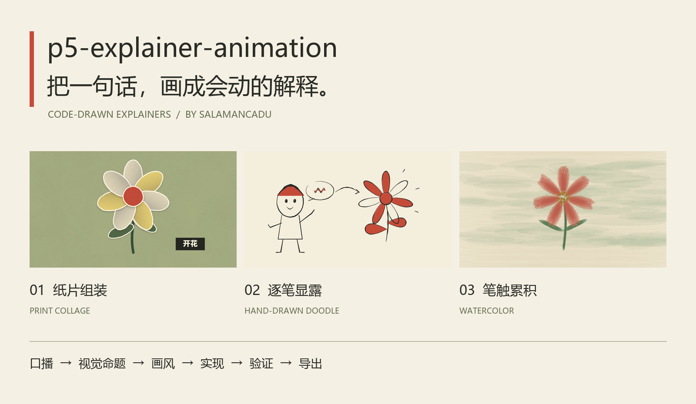
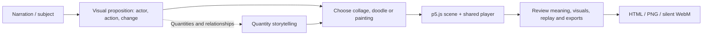
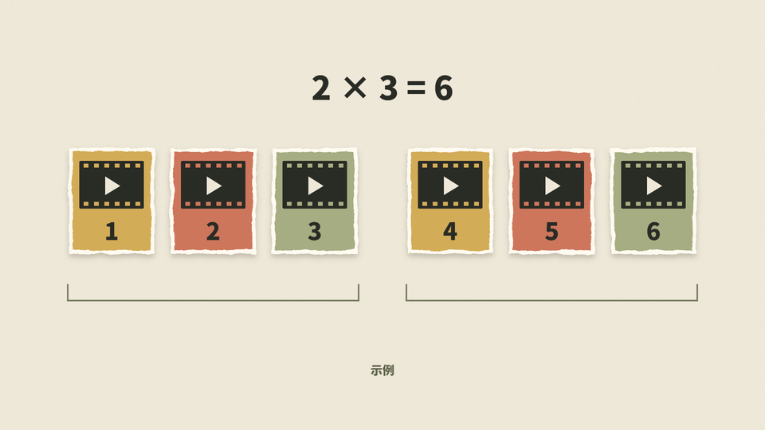

<div align="center">



# p5-explainer-animation

**An AI skill for code-drawn explainer animations.**

Turn narration, ideas and painting subjects into editable, replayable HTML animations with p5.js.

[Quick start](#quick-start) · [Examples](#one-idea-three-directions) · [Skill](skills/p5-explainer-animation/SKILL.md) · [中文](README.md)

MIT · Three visual styles · HTML / PNG / WebM · No image or video generation model required

</div>

## One idea, three directions

> Turn scattered ideas into a flower.


This GIF comes from real browser recordings of the included HTML examples. It is reduced in size and frame rate for display. Original silent WebM files and editable sources are linked below. GitHub shows HTML source; download the repository to play the examples locally.

| Direction | Visual event | Runnable HTML | Actual recording |
|---|---|---|---|
| **Print collage** | Torn paper pieces assemble into a flower; the last second freezes | [a.html](examples/flower/a.html) | [WebM](assets/previews/collage.webm) |
| **Hand-drawn doodle** | A character's idea leads to a flower drawn stroke by stroke; subtle line boil continues | [b.html](examples/flower/b.html) | [WebM](assets/previews/doodle.webm) |
| **Watercolor painting** | Broad washes, stems, petals and details accumulate; the finished stem gently moves | [c.html](examples/flower/c.html) | [WebM](assets/previews/painting.webm) |

[Synchronized comparison](examples/flower/compare.html) · [Example brief and prompts](examples/flower/README.md)

All three use a six-second logical timeline. The comparison page distributes one master logical frame to the other scenes. Watercolor is a procedural brush effect, not a pigment physics simulation.

## How it works



**Make the meaning visible, then choose materials and motion.** Preserve approximate quantities and supported causality. “A dozen or so” is not an exact twelve; “expensive” does not establish a budget overrun. Quantity storytelling can combine with any style. Reference analysis, three-direction exploration and saving personal style are optional modes.

| Capability | Reusable method |
|---|---|
| Print collage | Misregistered halftones, three-scale torn edges, white paper cores, staggered entrances |
| Hand-drawn doodle | Pressure-shaped strokes, path-length reveals, line boil on threes, offset fills |
| Watercolor / gouache / oil painting | Broad brush bodies, layered painting, dry-brush gaps, medium-specific opacity |
| Quantity storytelling | Counts, grouping, accumulation and evidence-supported thresholds |
| Reference and variants | Observations versus estimates, and distinct treatments of the same subject |

The detailed recipes remain in the Skill references. The main Skill and reference documents are in Chinese; this English README explains setup and capabilities but does not claim that every supporting document has been translated.

## Make quantities tangible



> Organize six clips into two groups of three.

Six objects remain six clips; the result is `2 × 3 = 6`. This is a fictional demonstration, not an external statistical claim.

[HTML](examples/quantity/index.html) · [WebM](assets/previews/quantity.webm) · [Brief and source](examples/quantity/README.md)

## Quick start

### Try an example

Download this repository and open `examples/flower/compare.html` in a modern Chromium-based browser, or open an individual example. The pages load pinned p5.js 1.11.11 from jsDelivr and Noto Sans SC from Google Fonts, so internet access is required by default.

Individual pages support **Space** to play/pause, **Home** to replay, **S** to save PNG, and **R** to record one full cycle as silent WebM. The comparison page has synchronized playback controls; open an individual page to export it.

### Use the Skill with an agent

Open the repository in an agent that can read local files and write HTML:

```text
Read skills/p5-explainer-animation/SKILL.md.
Create a six-second print-collage animation for:
“The more clips we collect, the longer it takes to organize them.”
Preserve the statement without adding quantities, prices or budget-overrun claims.
Deliver a runnable index.html and report which checks you actually performed.
```

For repeated use, copy the complete `skills/p5-explainer-animation/` directory into your host's supported Skill directory. Codex currently documents project-level `.agents/skills/` and user-level `~/.agents/skills/`; consult the [official installation guidance](https://developers.openai.com/codex/skills/). Preserve existing local edits instead of blindly overwriting another installation. Invoke `$p5-explainer-animation` once the host discovers it. Installation does not supply a model, browser, or runtime dependencies.

### Edit and maintain examples

Edit `examples/*/source/*.js`, then rebuild with an existing Python 3.10+ installation. Static checks also require an existing Node.js installation:

```bash
python scripts/build_examples.py
python scripts/check_project.py
```

The generated HTML inlines the scene and shared player. The Skill template is the maintained runtime source; rebuild examples after changing it. Browser checks require an existing Node.js, Playwright and Chrome / Chromium installation:

```bash
node skills/p5-explainer-animation/scripts/validate.mjs --output .local/runtime
node scripts/check_examples.mjs --output .local/examples
```

If package or browser discovery fails, pass `--playwright-module <absolute path to playwright/index.mjs>` and `--browser <browser executable>`. These scripts never install packages or download a browser. See the Chinese [development guide](docs/development.md) for preview generation and detailed verification boundaries.

## Delivery boundaries

- A single HTML file still has network dependencies. Offline use requires locally available, appropriately licensed library and font files.
- Output is silent by default. Narration text does not imply generated speech or word-level synchronization.
- Frames can be addressed deterministically, but real-time recording does not guarantee exactly 6.000 seconds or 180 encoded frames on every machine.
- The template is a working collage starter; an agent implements the scene for each requested style.
- Automated runtime checks do not establish artistic quality or semantic accuracy. Pixel identity across browsers and GPUs is not guaranteed.

## Working with Explainflow

[design-to-explainflow](https://github.com/SalamancaDu/design-to-explainflow) handles information design, layout, assets, titles and motion handoffs. This project implements short animations suited to code drawing and can also be used independently. Pass the source text, visual proposition, selected style, dimensions and delivery target. See [integration notes](docs/integration.md).

## Documentation and contributions

[Usage](docs/getting-started.md) · [Dependencies](docs/dependencies.md) · [Development](docs/development.md) · [Contributing](CONTRIBUTING.md) · [Provenance](NOTICE.md)

Project-owned content is licensed under [MIT](LICENSE), Copyright © 2026 SalamancaDu. Third-party libraries and fonts retain their own licenses; see [THIRD_PARTY_NOTICES](THIRD_PARTY_NOTICES.md).
