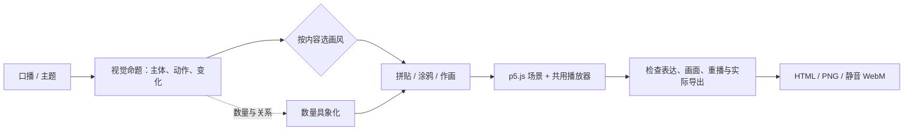

<div align="center">


# p5-explainer-animation

**口播配画面动画 Skill · 把一句话，画成会动的解释。**

用 AI 编写 p5.js，将口播、观点和作画主题变成可编辑、可重播、可导出的纯代码短动画。

[开始使用](#开始使用) · [真实示例](#一句话三个方向) · [Skill](skills/p5-explainer-animation/SKILL.md) · [使用文档](docs/getting-started.md) · [English](README.en.md)

MIT · 三种画风 · HTML / PNG / WebM · 无需图片或视频生成模型

</div>

## 一句话，三个方向

> 把零散的想法，变成一朵花。


预览来自仓库内实际 HTML 的浏览器录制。动图为缩小、降帧后的展示版本；原始静音 WebM 和可编辑源码见下表。GitHub 文件页展示 HTML 源码，下载仓库后才能直接打开播放。

| 方向 | 如何表达 | 可运行 HTML | 实际录像 |
|---|---|---|---|
| **复古拼贴** | 撕边纸片逐一拍入，组成一朵花；最后一秒完全定格 | [a.html](examples/flower/a.html) | [WebM](assets/previews/collage.webm) |
| **手绘涂鸦** | 人物产生想法，箭头引出逐笔画成的花；尾段线条轻微重绘 | [b.html](examples/flower/b.html) | [WebM](assets/previews/doodle.webm) |
| **水彩作画** | 从宽笔铺色到花枝、花瓣与花心；完成后花枝微动 | [c.html](examples/flower/c.html) | [WebM](assets/previews/painting.webm) |

[打开三方向比较页](examples/flower/compare.html) · [阅读示例简报与调用方式](examples/flower/README.md)

三个方向都是 6 秒逻辑时间线。比较页由一个主时钟发送逻辑帧；它们采用不同的画法和动作结构。水彩是程序笔触效果。

## 它怎样工作



**先让画面讲清意思，再选择纸张、线条与笔触。** “十几”不能变成未经提供的“×12”，“预算不小”不能被画成“已经超支”。数量表达是可以叠加的叙事方法，参考分析、三方向探索和风格保存按请求启用。

| 能力 | 保留的方法 | 适用场景 |
|---|---|---|
| 复古印刷拼贴 | 三色错版网点、三层噪声撕边、白纸芯、错峰拍入 | 观点、物件与编辑式解释画面 |
| 手绘涂鸦 | 压力线条、按路径显露、每三帧轻微重绘、错位填色 | 轻松叙事、人物动作与关系 |
| 水彩 / 水粉 / 油画作画 | 宽笔刷痕、分层作画、干笔飞白、媒介对应的叠色 | 形体与画面逐步形成 |
| 数量具象化 | 物件计数、分组、累积、真实阈值 | 需要看懂数量和关系的句子 |
| 参考与探索 | 区分观察和估计、同主题三方向比较 | 已有参考或需要选方向 |

三种画风的详细配方由 [Skill 画风索引](skills/p5-explainer-animation/SKILL.md#画风与默认值)链接到各参考文件；README 负责介绍和导航。

## 数量也可以看得见


> 把六段素材，整理成两组，每组三段。

六个物件始终对应六段素材，结尾为 `2 × 3 = 6`。这是自拟演示任务，不是外部统计数据。

[运行 HTML](examples/quantity/index.html) · [实际 WebM](assets/previews/quantity.webm) · [简报与源码](examples/quantity/README.md)

## 开始使用

### 1. 先体验动画

下载仓库，使用现代 Chromium 系浏览器打开 `examples/flower/compare.html`，或打开任意单独示例。默认从 jsDelivr 加载 p5.js 1.11.11，从 Google Fonts 加载 Noto Sans SC，需要联网。

单独示例支持：**空格**播放 / 暂停、**Home**重播、**S**保存 PNG、**R**从头录制一轮并下载静音 WebM。比较页提供同步播放控制；导出请打开单独示例。

### 2. 让代理按 Skill 创作

在能读取本地文件和编写 HTML 的代理中打开仓库：

```text
请读取 skills/p5-explainer-animation/SKILL.md。
为“素材越来越多，整理也越来越费时”制作 6 秒复古拼贴动画。
保持原句的近似含义，不增加价格、数量或超支结论。
交付可打开的 index.html，并说明实际完成了哪些检查。
```

也可将完整的 `skills/p5-explainer-animation/` 目录安装到宿主支持的 Skill 目录，然后使用 `$p5-explainer-animation`。具体步骤见[安装与使用](docs/getting-started.md)。安装 Skill 不会自动安装模型、浏览器或运行依赖。

### 3. 修改并维护示例

编辑 `examples/*/source/*.js` 中的场景，然后用已有 Python 3.10+ 重建；静态检查另需已有 Node.js：

```bash
python scripts/build_examples.py
python scripts/check_project.py
```

生成的 HTML 内联场景与播放器，可单独分享；修改播放器时以 Skill 内模板为准，重建所有示例。浏览器回归需已有 Node.js、Playwright 和 Chrome / Chromium，见[开发与验证](docs/development.md)。

## 交付边界

- **单 HTML 仍有联网依赖。** 离线使用需自行准备许可允许的库与字体，见[依赖和离线说明](docs/dependencies.md)。
- **默认静音。** 提供口播文字不会自动生成配音，也不代表逐词同步已完成。
- **逻辑帧可定位，实时录制有误差。** 不保证每台机器都得到精确 6.000 秒或 180 个编码帧。
- **模板与画风规则由代理组合。** 自带模板是拼贴起点；涂鸦、水彩需实现相应场景。
- **运行通过与画面质量分别检查。** 自动化不判断隐喻正确性、角色表现和艺术质量；跨浏览器、跨 GPU 的像素一致性不作保证。

## 与 Explainflow 配合

[design-to-explainflow](https://github.com/SalamancaDu/design-to-explainflow) 负责信息设计、版式、素材、标题与动效交接。本项目负责其中适合纯代码绘制的短动画实现，也可独立使用。对接时传递原文、视觉命题、已选风格、画幅与交付要求即可，详见[配合方式](docs/integration.md)。

## 文档与贡献

| 想做什么 | 去哪里 |
|---|---|
| 安装、调用、导出、排查加载问题 | [使用指南](docs/getting-started.md) |
| 了解联网、字体与离线要求 | [依赖说明](docs/dependencies.md) |
| 修改模板、复现测试、更新预览 | [开发与验证](docs/development.md) |
| 与设计生产工作流连接 | [集成说明](docs/integration.md) |
| 报告问题、提交改进 | [贡献指南](CONTRIBUTING.md) |
| 查看原创来源和第三方边界 | [NOTICE](NOTICE.md) |

项目自有内容采用 [MIT](LICENSE)，Copyright © 2026 SalamancaDu。第三方库和字体保留各自许可证，详见 [THIRD_PARTY_NOTICES](THIRD_PARTY_NOTICES.md)。
